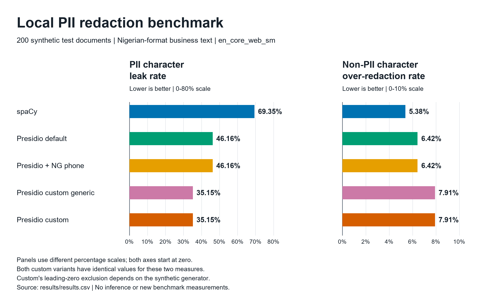
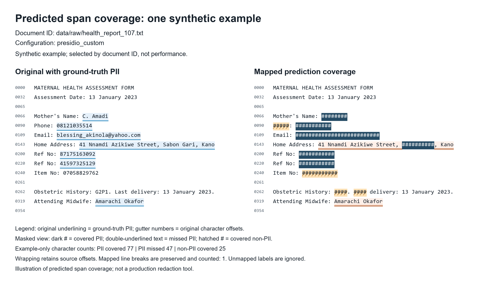

# pii-redaction-benchmark

A reproducible comparison of local personally identifiable information (PII) detection configurations on synthetic Nigerian-format business text. It measures how much annotated PII text remains uncovered and how much non-PII text is unnecessarily covered.

Names, addresses, phone formats, and administrative identifiers can vary across populations and document settings. Concerns about uneven detection motivate this focus; this experiment does not establish demographic bias or its causes.

The benchmark evaluates existing detection configurations. It does not train new models or provide a production document-protection service. All documents and personal details are synthetic.

## Data and scope

| Split | Documents | PII entities | Decoy annotations |
|---|---:|---:|---:|
| Full dataset | 300 | 1,840 | 550 |
| Dev | 100 | 615 | 173 |
| Test | 200 | 1,225 | 377 |

The full dataset has 100 health_report, 100 hr_intake, 100 vendor_invoice documents.

Full-dataset entity totals: PERSON 640, PHONE 320, EMAIL 200, ADDRESS 300, BVN 180, NIN 200.

Full-dataset decoy totals: INVOICE_NUMBER 220, PO_NUMBER 60, ORDER_ID 150, AMOUNT 120.

Test ID denominators: 257 IDs (151 cued, 106 bare). Full-dataset totals are not test-set denominators.

Documents are built from five templates per domain, with offsets recorded during construction. Entity types are PERSON, PHONE, EMAIL, ADDRESS, BVN, and NIN. BVN/NIN are merged into ID for scoring because bare 11-digit strings cannot be distinguished by format alone.

## Five configurations

All configurations use the full default `en_core_web_sm` spaCy pipeline. Presidio adds its recognizer framework; the spaCy baseline uses only the pipeline's returned NER entities as predictions.

| Configuration | Detection setup |
|---|---|
| `spacy` | Raw spaCy NER spans; no additional recognizers. |
| `presidio_default` | Presidio default recognizers with `en_core_web_sm` explicitly selected. |
| `presidio_ng_phone` | Default recognizers plus an NG-region phone recognizer; defaults are retained. |
| `presidio_custom_generic` | NG phone configuration plus BVN/NIN patterns, context words, and generic 11-digit recognition from dev experiment 01. |
| `presidio_custom` | The same setup, excluding 11-digit candidates starting with zero, from dev experiment 02. |

Only custom rules were tuned, using dev documents. The selection criterion (highest observed strict dev ID recall, then overall strict micro precision) was applied **after observing the experiments**, not preregistered. Both custom variants were retained and frozen by source SHA-256 in [freeze.json](results/freeze.json). See the [dev experiment log](results/tuning_log.md).

The recorded sequence was baseline dev/test prediction generation (`dd6b474`), dev-only tuning (`26ed015`), a two-source freeze (`853bcbb`), then regeneration of all five test predictions (`da55731`). Evaluation and reporting corrections subsequently rescored those stored predictions without inference. Test error records were first generated after freeze; this was not a single prediction run per configuration.

## Test results

Values below come from [results.csv](results/results.csv), rounded to two decimal places. Character leak and over-redaction are lower-is-better; ID precision and recall are higher-is-better.

| Configuration | Character leak | Character over-redaction | Strict ID precision | Strict ID recall |
|---|---:|---:|---:|---:|
| `spacy` | 69.35% | 5.38% | 0.00% | 0.00% |
| `presidio_default` | 46.16% | 6.42% | 0.00% | 0.00% |
| `presidio_ng_phone` | 46.16% | 6.42% | 0.00% | 0.00% |
| `presidio_custom_generic` | 35.15% | 7.91% | 57.66% | 99.61% |
| `presidio_custom` | 35.15% | 7.91% | 79.01% | 99.61% |

The scorer reports ID precision as zero when no ID predictions exist; that convention applies to the first three configurations. Strict ID recall requires the correct mapped type and exact span after one-to-one assignment.

Custom ID rules improved character coverage on this test set. Names and addresses remain substantial gaps. The two custom variants have equal aggregate character leakage and over-redaction despite different ID precision; equal rates do not establish identical covered character positions.

The leading-zero exclusion benefits from the generator: it never emits BVN/NIN values starting with zero. These findings do not establish performance on real business records.



Comparison from the supplied CSV. Both custom configurations have equal bars for these two measures. The panels explicitly use different scales.



Example: `data/raw/health_report_107.txt`, configuration `presidio_custom`. It is the first test document in lexicographic document-ID order, selected without performance searching and **not claimed to be representative**. The illustration preserves line breaks and uses character unions; it is not a production redaction tool.

## Reading the metrics

- **Character leak:** uncovered annotated PII characters divided by all annotated PII characters.
- **Character over-redaction:** covered non-PII characters divided by all non-PII characters.
- **Entity exposure:** entities with at least one uncovered character, divided by all entities. Reports include fully uncovered and partially exposed counts.
- **Strict/overlap precision and recall:** computed after overlap-first greedy assignment. Label correctness and exactness do not get priority; equal-span competing labels can be resolved by prediction order. A matcher miss is an unassigned entity, not necessarily an entity with no covered characters.
- **Decoy-hit predictions:** unmatched mapped predictions hitting a decoy, counting only the first overlapping decoy per prediction. The separate distinct ORDER_ID diagnostic counts decoy annotations touched by ID predictions. Neither substitutes for character over-redaction.
- **Timing:** five preliminary dev analysis calls are unrecorded. Main median/p95 use all stored test timings; the unchanged scorer's additional five-timing exclusion is retained in separate CSV/JSON fields. p95 is the 95th percentile, not outlier removal.

Coverage uses the union of **all mapped** predicted spans, independent of assignment and label correctness. Unmapped raw labels are retained in prediction files but do not count as masking. This is the scorer's stated mapping policy, not a claim about every span Presidio can detect.

Read the [methodology](docs/methodology.md), [full generated results](results/results.md), and [error analysis with synthetic snippets](results/error_analysis.md). [Evaluation details](results/evaluation_details.json) retain exact values and provenance.

## Reproduce in Windows PowerShell

The recorded environment used Python 3.12.6; pinned packages, including the spaCy model wheel, are in [requirements.txt](requirements.txt). Arial and Consolas Windows fonts and Pillow are required for figures. Font paths, versions, input hashes, commands, and original PNG hashes are in the [figure manifest](results/figures/manifest.json). Pillow exports PNG here, not SVG.

### 1. Inspect supplied results and rerender without inference

From this repository, inspection does not need model execution:

```powershell
Get-Content results/results.md
Import-Csv results/results.csv | Format-Table config,leak_rate,over_redaction_rate
Get-FileHash results/figures/benchmark_comparison.png,results/figures/document_example.png -Algorithm SHA256
```

The figure scripts check every protected entry and current report hash in [reporting_integrity.json](results/reporting_integrity.json), then both custom freeze hashes. That historical inventory includes the **old README**. The publication README intentionally differs, so rendering directly from the publication tree fails that check. Preserve the manifests and use the unchanged evidence commit for rerendering; do not remove or bypass the guard.

With an existing environment created by workflow 2, use a separate local archive clone:

```powershell
$benchmarkPython = (Resolve-Path .\venv\Scripts\python.exe).Path
git clone -c core.autocrlf=false . ..\pii-benchmark-figures
Set-Location ..\pii-benchmark-figures
git checkout --detach 054a1ff

# Restore the exact recorded mixed newline format, without changing text content.
# Other evidence files stay LF; these two historical files were recorded as CRLF.
foreach ($name in @('AGENTS.md', 'requirements.txt')) {
    $recordedPath = Join-Path (Get-Location) $name
    $recordedText = [System.IO.File]::ReadAllText($recordedPath)
    [System.IO.File]::WriteAllText($recordedPath, ($recordedText -replace "\r?\n", "`r`n"), [System.Text.UTF8Encoding]::new($false))
}
& $benchmarkPython scripts/plot_benchmark.py
& $benchmarkPython scripts/render_document_example.py --config presidio_custom
```

These commands rerender the two PNGs and update the figure manifest **only in the archive clone**. Optional example selection is `--doc-id 'data/raw/health_report_107.txt'`; `--config` accepts the five configuration names above. Exact PNG bytes also depend on the recorded Pillow/font versions. The committed PNGs remain available for inspection without rerendering.

### 2. Reproduce detection and evaluation in a fresh environment

Use a separate clone for new runs. Installing requirements needs network access; the model wheel is already included, so a separate spaCy model download is unnecessary.

```powershell
git clone -c core.autocrlf=false https://github.com/KingsAxe/pii-redaction-benchmark.git pii-benchmark-repro
Set-Location pii-benchmark-repro
py -3.12 -m venv venv
.\venv\Scripts\python.exe -m pip install -r requirements.txt
.\venv\Scripts\python.exe -m unittest discover -s tests -v

# REGENERATES tracked data/raw/*.txt and data/ground_truth.json with seed 42.
# Omit this command to keep the supplied data; verification below is read-only.
.\venv\Scripts\python.exe scripts/generate_data.py
.\venv\Scripts\python.exe scripts/verify_ground_truth.py

# Runs inference and creates NEW predictions/timings in a separate directory.
# Every runner also rewrites tracked results/environment.txt.
.\venv\Scripts\python.exe scripts/run_spacy.py --splits dev test --output-dir reproduction/predictions
if ($LASTEXITCODE -ne 0) { throw 'spaCy runner failed' }
foreach ($config in @('default','ng_phone','custom_generic','custom')) {
    .\venv\Scripts\python.exe scripts/run_presidio.py --config $config --splits dev test --output-dir reproduction/predictions
    if ($LASTEXITCODE -ne 0) { throw "Runner failed: $config" }
}
.\venv\Scripts\python.exe scripts/validate_predictions.py reproduction/predictions/spacy__test.json reproduction/predictions/presidio_default__test.json reproduction/predictions/presidio_ng_phone__test.json reproduction/predictions/presidio_custom_generic__test.json reproduction/predictions/presidio_custom__test.json --split test
if ($LASTEXITCODE -ne 0) { throw 'Prediction validation failed' }
.\venv\Scripts\python.exe scripts/evaluate.py --predictions-dir reproduction/predictions --output-dir reproduction/reports
```

Both custom sources must match their existing freeze hashes before test execution. Do not retune them or recreate a freeze to make a failed check pass. Prediction keys preserve `doc_id` when supplied; this legacy dataset has no such field, so its exact `file` value is used as the ID.

The alternate directories keep the supplied predictions and reports intact. Without `--output-dir`, runners overwrite tracked `data/predictions/<config>__<split>.json`; the evaluator defaults to overwriting the tracked reports in `results/`. Timings vary by machine and run, even with seed 42. Rescoring existing predictions does not run models, but rewrites report timestamps/provenance when using the default output directory.

Fresh data or inference can change hashes, timing values, and environment provenance. The original test-run, reporting-integrity, and figure manifests describe the supplied evidence, not new runs. The figure scripts have no option to consume `reproduction/reports` and will reject stale integrity records. This repository provides no automatic provenance-rebuild command: a new evidence package would need source/freeze verification, prediction validation and run provenance, report generation, a reviewed integrity snapshot, then figure generation and its manifest, in that order. Use workflow 1 for the supplied figures; do not silently relabel old manifests as new-run evidence.

Presidio email validation uses tldextract's bundled public-suffix snapshot, with network fetching and machine-dependent caching disabled. This is fixed across the compared Presidio configurations; dependency installation is separate from offline benchmark execution.

## Limitations

- Small, synthetic, template-based data. Dev and test share a generator and templates, limiting independence and generalisation.
- The leading-zero exclusion exploits a generator property; it is not a universal BVN/NIN rule. Bare IDs and order numbers remain ambiguous.
- Only one spaCy model is compared. Names and addresses remain incomplete, and demographic causes cannot be inferred from these synthetic results.
- Clean text only: no OCR or scanned-document evaluation.
- Overlap-first assignment, prediction-order ties, and mapped-label-only coverage affect interpretation. Equal aggregate rates need not mean equal character positions.
- Single sequential timing runs reflect host load, caches, and run order; no universal speed ranking is established.
- The supplied hashes record exact historical bytes, including mixed newlines and the pre-publication README. Fresh runs require separate provenance; historical manifests are preserved.

## Repository map

| Path | Contents |
|---|---|
| `data/raw/`, `data/ground_truth.json` | Synthetic text, splits, entities, decoys, and character offsets. |
| `data/predictions/` | Stored spans with raw labels and per-document timings. |
| `scripts/` | Generation, verification, frozen recognizers, runners, scoring, evaluation, and figure scripts. |
| `tests/` | Hand-built scoring, runner, reporting, and character-coverage checks. |
| `results/` | Generated tables, error records, environment, freeze, and historical provenance. |
| `results/tuning/`, `results/tuning_log.md` | Archived dev experiments and review decisions. |
| `results/figures/` | Original PNGs and rendering provenance. |
| `docs/` | Methodology, phase specification, and current handoff state. |

LinkedIn posting and gateway, OCR, and governance work are separate from this repository publication.
